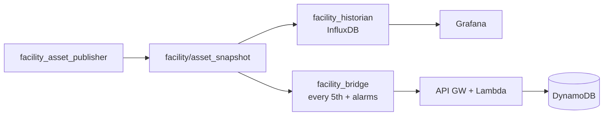

# Industrial Cell Telemetry Bridge

Simulated plant telemetry on a **C++ / ROS 2 Jazzy** edge, with a local historian and a thin **AWS** copy (API Gateway → Lambda → DynamoDB). Weld and cell paths also emit rule alerts as CloudWatch log events where those contracts say so.

**License:** [MIT](LICENSE)  
**Stack:** C++20 · ROS 2 Jazzy · Docker Compose · HTTPS JSON · API Gateway · Python 3.12 Lambda · DynamoDB · InfluxDB · Grafana · Serverless Framework

---

## Releases

Three frozen slices. This branch is the facility path. Earlier paths stay as tagged.

| Release | Frozen path |
|---------|-------------|
| [v1.0.0](https://github.com/jurmanec/ros2-cell-telemetry-bridge/releases/tag/v1.0.0) | One cell on `cell/telemetry`, full `schema_version` 1 batches, `CELL_ALERT` in CloudWatch. [SHIPPED](https://github.com/jurmanec/ros2-cell-telemetry-bridge/blob/v1.0.0/docs/SHIPPED.md) on that tag. |
| [v2.0.0](https://github.com/jurmanec/ros2-cell-telemetry-bridge/releases/tag/v2.0.0) | Two weld cells on `cell/weld_snapshot`. Influx keeps every snapshot; bridge posts every fifth plus alarms. |
| [v3.0.0](https://github.com/jurmanec/ros2-cell-telemetry-bridge/releases/tag/v3.0.0) | Hall assets (CRAH / ROOM / UPS) on `facility/asset_snapshot`. Influx bucket `facility`; reduced `schema_version` 3 cloud copy. Timelines in `edge/scenarios/`. |

Demos: [facility](docs/how-to/facility-demo.md) · [weld](docs/how-to/weld-demo.md) · [edge → AWS](docs/how-to/edge-to-aws.md)

---

## Quick start

**Cloud smoke** (deployed `dev` + credentials): see [cloud/README.md](cloud/README.md).  
**Local cell + stub:** `cd edge && ./scripts/run_m2_stack.sh` — [edge/README.md](edge/README.md).  
**Facility hall → live ingest:** [facility-demo.md](docs/how-to/facility-demo.md) (`docker compose --profile facility up facility_demo`).

---

## Layout

| Path | Role |
|------|------|
| [`edge/`](edge/) | ROS packages, Compose, scenarios, stub ingest |
| [`cloud/`](cloud/) | Serverless ingest, DynamoDB, smoke |
| [`docs/`](docs/) | Architecture, contracts, ADRs, how-tos |

**Out of scope:** hardware, control, fleet ops, push notify, learned anomaly models, store-and-forward.

Start with [ARCHITECTURE](docs/ARCHITECTURE.md), [facility notes](docs/v3/facility-telemetry.md), and [v1 SHIPPED](docs/v1/SHIPPED.md).
