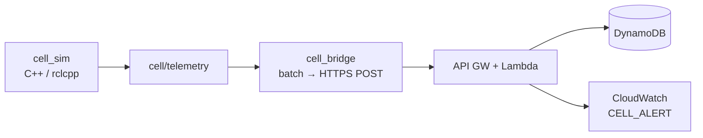

# Industrial Cell Telemetry Bridge

**Status:** v1 frozen (2026-07-15) · **License:** [MIT](LICENSE)  
**GitHub:** `ros2-cell-telemetry-bridge` (portfolio P3)

Simulated manufacturing-cell telemetry on a **C++ / ROS 2 Jazzy** edge, batched over HTTPS to a thin **AWS** ingest path that persists samples and emits **rule-based** health events as CloudWatch logs.

**What this is:** an edge→cloud **data-path tracer** — ROS 2 / `rclcpp` scaffolding plus known cloud patterns (API Gateway, Lambda, DynamoDB, smoke).  
**What this is not:** real sensors, robot control, actuators, a robot model, or trained ML. Alerts for v1 are **structured log events** (`CELL_ALERT`), not SNS/Slack/Paging.

**Stack:** C++20 · ROS 2 Jazzy (`rclcpp`) · Docker Compose · HTTPS JSON batches · API Gateway HTTP API · Python 3.12 Lambda · DynamoDB · Serverless Framework · CloudWatch structured logs

Docs: [CHARTER](docs/CHARTER.md) · [ARCHITECTURE](docs/ARCHITECTURE.md) · [SHIPPED vs deferred](docs/SHIPPED.md) · [Milestones](docs/MILESTONES.md)

---

## Architecture



Happy path: publish → bridge batches → ingest validates → persist samples → rule on `fault` → `CELL_ALERT` log → [smoke](cloud/scripts/smoke_ingest.py) asserts the chain.

---

## Skills demonstrated

- **C++ / ROS 2** — custom msgs, `rclcpp` publisher + bridge node, Docker/Jazzy workflow on macOS  
- **Edge→cloud contracts** — wire docs, ADRs, HTTPS batch ingest with API-key auth  
- **Thin AWS floor** — Serverless deploy, Lambda, DynamoDB, structured log “alert” channel  
- **Verification** — unit tests + post-deploy smoke (HTTP → Dynamo → CloudWatch)  
- **Scope discipline** — charter, milestones, explicit shipped vs deferred (v1 freeze)

---

## How to demo

### A. Cloud happy path (fastest)

Requires a deployed `dev` stack and AWS credentials:

```bash
cd cloud
cp .env.example .env   # set INGEST_API_KEY; deploy if not already
npm install
npx serverless deploy --stage dev --region us-east-1
.venv/bin/pip install -r requirements.txt   # once
.venv/bin/python scripts/smoke_ingest.py    # expect SMOKE PASSED
```

Details: [cloud/README.md](cloud/README.md). Events: [docs/contracts/cloud-ingest-events.md](docs/contracts/cloud-ingest-events.md).

### B. Local edge + stub

```bash
cd edge
./scripts/run_m2_stack.sh    # publisher + bridge + stub ingest
```

Details: [edge/README.md](edge/README.md).

### C. Edge → live AWS

Point `cell_bridge` at IngestUrl with `api_key` matching `INGEST_API_KEY` — see [cloud/README.md](cloud/README.md#point-the-edge-bridge-at-cloud).

---

## Repo map

| Path | Role |
|------|------|
| [`edge/`](edge/) | Jazzy packages `cell_msgs`, `cell_sim`, `cell_bridge`; Compose + stub ingest |
| [`cloud/`](cloud/) | Serverless ingest Lambda, DynamoDB, smoke script |
| [`docs/contracts/`](docs/contracts/) | Telemetry + HTTP batch + ingest log events |
| [`docs/decisions/`](docs/decisions/) | ADRs (C++20, HTTPS bridge, AWS cloud floor) |
| [`spike/ros2/`](spike/ros2/) | Historical Humble spike (throwaway) |

---

## Follow-ons (not v1)

- **P3.1 MLOps** — small anomaly model on the Dynamo series (e.g. ONNX), deploy, observe, fail gracefully  
- Optional polish: SNS/Slack notify, pure-JSON Lambda logs, Compose→cloud one-shot, GitHub Actions  
- Deeper robotics: real sensors/control, richer cell models (beyond this tracer)

Pre-charter notes: [docs/archive/](docs/archive/).
