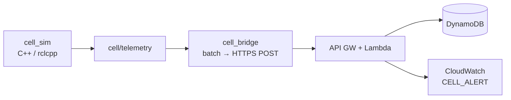

# Industrial Cell Telemetry Bridge

Simulated manufacturing-cell telemetry on a **C++ / ROS 2 Jazzy** edge, batched over HTTPS into a thin **AWS** path that stores samples and emits **rule-based** health alerts as CloudWatch log events.

**License:** [MIT](LICENSE)

This is an end-to-end **edge → cloud telemetry path** (ROS publisher, HTTPS bridge, API Gateway, Lambda, DynamoDB). It is **not** real sensors, robot control, or ML — alerts in this version are structured `CELL_ALERT` log events, not SNS/Slack.

**Stack:** C++20 · ROS 2 Jazzy (`rclcpp`) · Docker Compose · HTTPS JSON · API Gateway · Python 3.12 Lambda · DynamoDB · Serverless Framework · CloudWatch

---

## Architecture



Flow: publish → batch over HTTPS → validate → persist → on `fault` emit `CELL_ALERT` → [smoke](cloud/scripts/smoke_ingest.py) can assert the chain.

---

## Quick start

### Cloud only (fastest)

Needs a deployed `dev` stack and AWS credentials:

```bash
cd cloud
cp .env.example .env   # set INGEST_API_KEY
npm install
npx serverless deploy --stage dev --region us-east-1
.venv/bin/pip install -r requirements.txt
.venv/bin/python scripts/smoke_ingest.py    # expect SMOKE PASSED
```

More: [cloud/README.md](cloud/README.md) · [event contract](docs/contracts/cloud-ingest-events.md)

### Local edge + stub ingest

```bash
cd edge
./scripts/run_m2_stack.sh    # publisher + bridge + local stub
```

More: [edge/README.md](edge/README.md)

### Edge → live AWS

[docs/how-to/edge-to-aws.md](docs/how-to/edge-to-aws.md)

---

## Repository layout

| Path | Role |
|------|------|
| [`edge/`](edge/) | ROS packages, Compose, local stub ingest |
| [`cloud/`](cloud/) | Serverless ingest, DynamoDB, smoke script |
| [`docs/`](docs/) | Architecture, contracts, ADRs, how-tos |
| [`spike/ros2/`](spike/ros2/) | Earlier Humble spike (historical) |

---

## Scope and next steps

**In scope here:** simulated cell → HTTPS bridge → AWS persist + rule alerts in logs.

**Out of scope:** hardware, control, operator UI, push notifications, learned anomaly models.

Possible follow-ons: SNS/Slack notify, richer logging, CI, a small model on the Dynamo series.

Design notes (charter, architecture, milestones): [docs/](docs/) — start with [ARCHITECTURE](docs/ARCHITECTURE.md) and [SHIPPED vs deferred](docs/SHIPPED.md).
