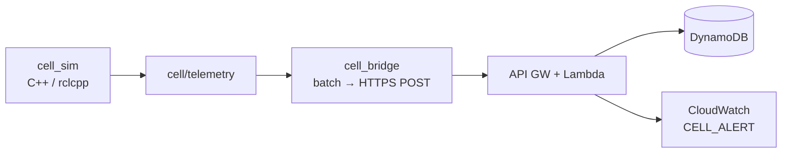
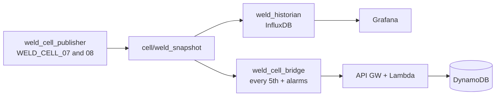

# Industrial Cell Telemetry Bridge

Simulated manufacturing-cell telemetry on a **C++ / ROS 2 Jazzy** edge, batched over HTTPS into a thin **AWS** path that stores samples and emits **rule-based** health alerts as CloudWatch log events.

**License:** [MIT](LICENSE)

This is an end-to-end **edge → cloud telemetry path** (ROS publisher, HTTPS bridge, API Gateway, Lambda, DynamoDB).

**Stack:** C++20 · ROS 2 Jazzy (`rclcpp`) · Docker Compose · HTTPS JSON · API Gateway · Python 3.12 Lambda · DynamoDB · InfluxDB · Grafana · Serverless Framework · CloudWatch

---

## Slices

Two frozen releases. This branch is the weld slice. The cell path in v1 is unchanged.

| Release | What is frozen |
|---------|----------------|
| [v1.0.0](https://github.com/jurmanec/ros2-cell-telemetry-bridge/releases/tag/v1.0.0) | One simulated cell, `cell/telemetry`, full `schema_version` 1 batches to DynamoDB, `CELL_ALERT` in CloudWatch. Shipped list: [docs/SHIPPED.md](https://github.com/jurmanec/ros2-cell-telemetry-bridge/blob/v1.0.0/docs/SHIPPED.md) on that tag. |
| [v2.0.0](https://github.com/jurmanec/ros2-cell-telemetry-bridge/releases/tag/v2.0.0) | Two weld cells on `cell/weld_snapshot`. InfluxDB keeps every snapshot. The bridge posts every fifth snapshot, plus any snapshot that carries an alarm. |

---

## Architecture

v1 cell path:



Flow: publish → batch over HTTPS → validate → persist → on `fault` emit `CELL_ALERT` → [smoke](cloud/scripts/smoke_ingest.py) can assert the chain.

Weld path on this branch:



`cell_id` is on the snapshot. One plant historian and one bridge subscribe to the same topic. Start the weld demo from [docs/how-to/weld-demo.md](docs/how-to/weld-demo.md).

---

## Quick start

### Cloud only (fastest)

Needs a deployed `dev` stack and AWS credentials:

```bash
cd cloud
cp .env.example .env   # set INGEST_API_KEY; set INGEST_URL after deploy
npm install
npx serverless deploy --stage dev --region us-east-1
.venv/bin/pip install -r requirements.txt
.venv/bin/python scripts/smoke_ingest.py    # expect SMOKE PASSED
```

More: [cloud/README.md](cloud/README.md) · [event contract](docs/contracts/cloud-ingest-events.md)

### Local edge + stub ingest

```bash
cd edge
./scripts/run_m2_stack.sh    # publisher + bridge + local stub
```

More: [edge/README.md](edge/README.md)

### Edge → live AWS

[docs/how-to/edge-to-aws.md](docs/how-to/edge-to-aws.md)

---

## Repository layout

| Path | Role |
|------|------|
| [`edge/`](edge/) | ROS packages, Compose, local stub ingest |
| [`cloud/`](cloud/) | Serverless ingest, DynamoDB, smoke script |
| [`docs/`](docs/) | Architecture, contracts, ADRs, how-tos |
| [`spike/ros2/`](spike/ros2/) | Earlier Humble spike (historical) |

---

## Scope and next steps

**v1, on the v1.0.0 tag:** simulated cell → HTTPS bridge → AWS persist + rule alerts in logs.

**This branch:** that cell path, plus two weld cells, a local InfluxDB historian, Grafana on that historian, and a reduced cloud copy.

**Out of scope:** hardware, control, a bridge on every machine, fleet operations, push notifications, learned anomaly models.

Design notes (charter, architecture, milestones): [docs/](docs/) — start with [ARCHITECTURE](docs/ARCHITECTURE.md) and [SHIPPED vs deferred](docs/SHIPPED.md).
