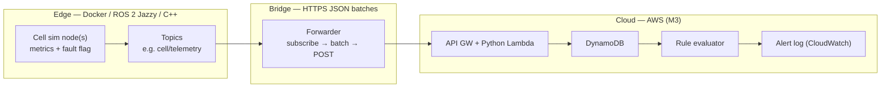

# Architecture (v1 one-pager)

**Status:** v1 frozen (2026-07-15)  
**Date:** 2026-07-14 (freeze note 2026-07-15)  
**Authority:** [CHARTER.md](CHARTER.md) — cloud choices [ADR 0003](decisions/0003-cloud-floor.md). Scope: [SHIPPED.md](SHIPPED.md).

---

## Context

Simulated **manufacturing cell** on a **C++ / ROS 2 Jazzy** edge publishes telemetry; a **bridge** forwards it to a **thin cloud** path that stores series and fires **rule-based** health alerts. Demo surface: ROS/terminal + smoke + logs (+ alert side effect). No SPA in v1.

Dev loop (from spike): edit on macOS → build/run ROS graph in **Docker (Linux, arm64)**.

---

## End-to-end (v1)

**Happy path:** cell publishes → bridge forwards → cloud persists → rule matches → alert observable → smoke asserts the chain.

---

## Components

| Box | Responsibility (v1) | Notes |
|-----|---------------------|--------|
| **Cell sim** | 1–2 `rclcpp` nodes; publish temperature, vibration, cycle, fault (or equivalent) | Primary engineering investment; no hardware |
| **Topics** | Wire shape for telemetry (start simple; custom msgs OK) | Contract documented under `contracts/` when scaffolded |
| **Bridge** | ROS subscribe → batch/serialize → cloud egress | Lives near edge (container or companion process); not a second product |
| **Ingest** | Accept batches; validate; ack/fail clearly | Deployable one stage is enough |
| **Store** | Append-only / time-series persistence | **DynamoDB** ([ADR 0003](decisions/0003-cloud-floor.md)) |
| **Rules** | Threshold / boolean rules on recent samples | Not learned baselines (P3.1); fault rule in ingest Lambda |
| **Alert** | Observable side effect for demo + smoke | **Structured CloudWatch logs** (M3); event fields [cloud-ingest-events.md](contracts/cloud-ingest-events.md); SNS/Slack deferred |
| **Smoke / logs** | One automated journey; structured logs on critical hops | M4 — see [MILESTONES.md](MILESTONES.md); events contract above |

---

## Locked vs open

| Topic | Status |
|-------|--------|
| Domain | **Locked** — manufacturing cell |
| Edge language / framework | **Locked** — C++ / `rclcpp` / ROS 2 **Jazzy** |
| Edge runtime on Mac | **Locked** — Docker Linux |
| Cloud depth | **Locked** — credibility floor only |
| Demo UI | **Locked out** — no SPA v1 |
| Bridge transport | **Locked** — HTTPS POST / JSON batches ([ADR 0002](decisions/0002-bridge-transport.md)); MQTT deferred |
| Cloud provider / services | **Locked (M3)** — AWS API GW + Python Lambda + DynamoDB ([ADR 0003](decisions/0003-cloud-floor.md)) |
| Store technology | **Locked (M3)** — DynamoDB on-demand ([ADR 0003](decisions/0003-cloud-floor.md)) |
| Alert channel | **Locked (M3)** — structured CloudWatch logs; SNS/Slack deferred ([ADR 0003](decisions/0003-cloud-floor.md)) |
| C++ standard | **C++20** ([ADR 0001](decisions/0001-cpp-standard.md)) |
| Exact topic / message schema | **Locked (M1)** — `cell_msgs/msg/CellTelemetry` on `cell/telemetry` ([contract](contracts/cell-telemetry.md)) |

---

## Trust boundaries (sketch)

| Boundary | Meaning |
|----------|---------|
| ROS graph | Local / Docker network; not exposed as public API |
| Bridge → cloud | Authenticated egress (**API key** per ADR 0003); untrusted input at ingest |
| Cloud store / rules | Same deployable unit or minimal split — prefer simple for v1 |

---

## Explicit non-goals (architecture)

- Multi-cell fleet, digital twin, MES/SCADA integration  
- Operator console / rich dashboard  
- Model serving / learned anomaly (P3.1)  
- Parity with P0 observability/CD sophistication  

---

## Next

v1 milestones **M0–M5** complete. Demo: root [README](../README.md). Follow-ons: [SHIPPED.md](SHIPPED.md) (P3.1 MLOps, optional polish, robotics depth).

