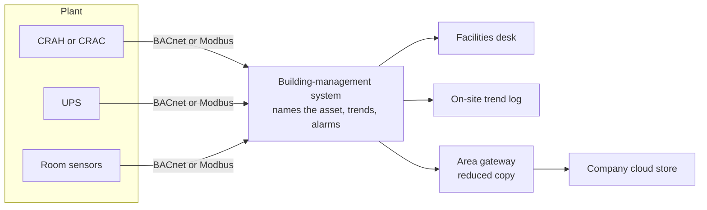
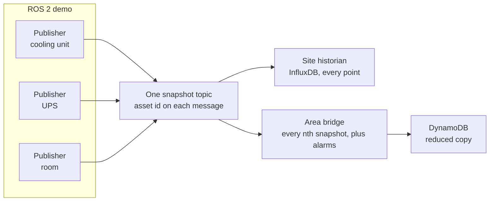

# Building-management system, and the ROS 2 stand-in

**Status:** Notes only. Not started.  
**Date:** 2026-11-12  
**Context:** [facility-telemetry.md](facility-telemetry.md), [facilities-and-software-monitoring.md](../concepts/data-centers/facilities-and-software-monitoring.md)

A building-management system (BMS) is the local integration layer for a data-center plant. This demo does not speak to real cooling or power gear. ROS 2 publishers stand in for that layer: they emit one snapshot per asset, and the historian and the bridge subscribe.

---

## What a BMS does

The mechanical and electrical plant sits under the BMS. Chillers, CRAH or CRAC units, pumps, UPS cabinets, and room sensors each speak their own protocol, usually BACnet or Modbus. The BMS is the system that talks to them.

It names each device, trends the points, and raises an alarm when a unit leaves its setpoint. The facilities desk lives in that system. A page from it can send someone to a breaker, a valve, or a cooling unit.

The BMS keeps that record on site. It does not, by itself, post a reduced copy to a company cloud store. That hop is a gateway above the BMS.

---

## What ROS 2 stands in for

ROS 2 takes the place of the BMS, not the place of the chillers or the UPS cabinets. A publisher for each asset invents the readings that asset's controller would have reported, stamps the asset id, and publishes one snapshot. The site historian and the area bridge subscribe to that topic. Nothing in the demo speaks BACnet. The topic is the stand-in for the BMS point list.

The bridge is still a separate process. It posts every nth snapshot, plus any snapshot that carries an alarm. The InfluxDB historian stands in for the on-site trend log.

On a real plant network the snapshot would leave the hall by a gateway protocol. This demo keeps one ROS 2 topic because the publishers, the historian, and the bridge share one lab network. A factory-wide DDS domain is not the plant layout. See the same limit on the weld path: both cells publish `cell/weld_snapshot` inside one container.

---

## Where the stand-in stops

| BMS on a site | This demo |
|---------------|-----------|
| Polls real controllers over BACnet or Modbus | Publishers invent the readings |
| Names assets and raises alarms from setpoints | The publisher stamps the asset id and the scripted fault |
| Trends points in its own log | InfluxDB keeps every snapshot |
| A gateway north of the BMS sends a reduced copy | The ROS 2 bridge posts that copy |

One snapshot remains one asset. Site, hall, and asset are tags on that snapshot. The weld topic and `schema_version` 2 stay the weld contract. The facility records use a new topic and a new snapshot type.
